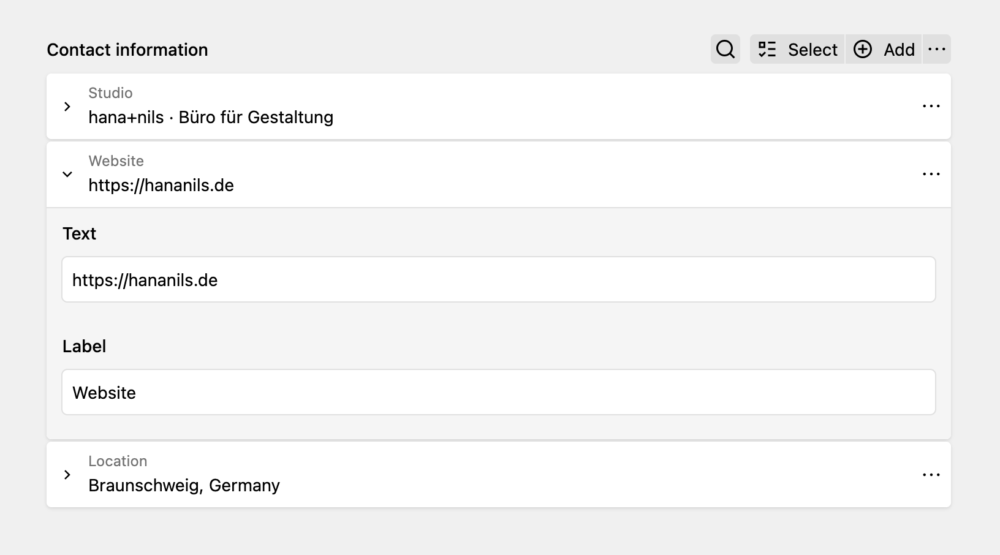
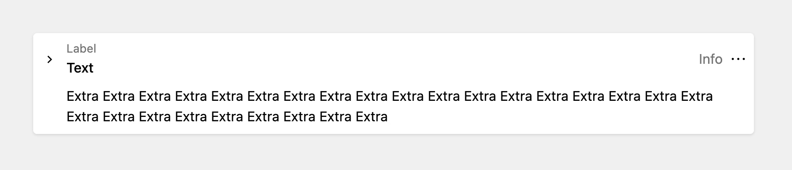
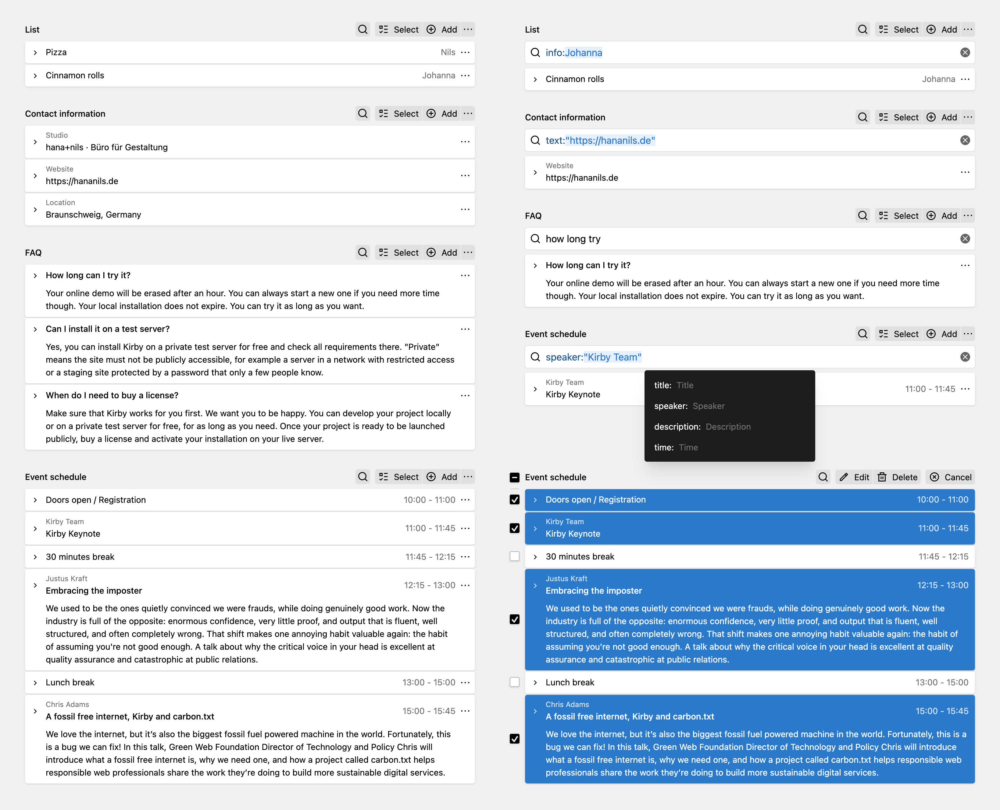
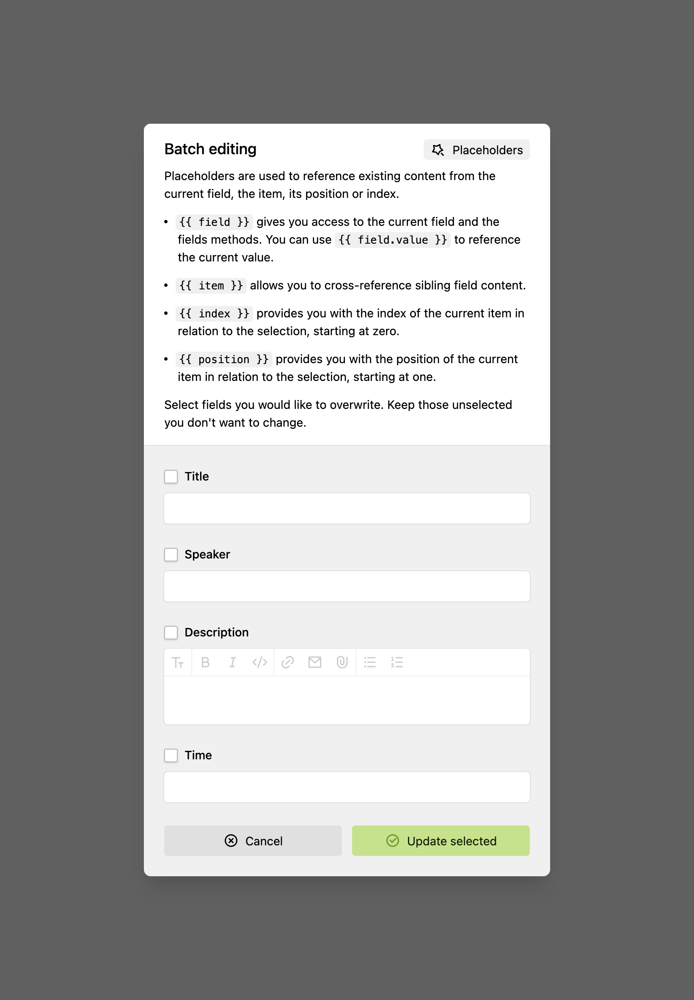

Structure Accordion is an alternative approach to structured data management in Kirby. It features an accordion user interface with inline editor, batch editing functions and advanced search capabilities. For multilingual sites, it automatically synchronises content between languages.

> [!NOTE]
> This plugin requires at least Kirby 6 Beta 1.

# Introduction



Structure Accordion stores its content in the same format as the core Structure field which makes it easy to switch between field types. Conceptually though, Structure Accordion has a different focus on how content is edited:

1. Items are displayed as a list, similar to how `pagelist` fields present their content. Each item is represented by a summary you can customise in the blueprint. This makes it more suitable for non-tabular data, think of FAQs for example or data sheets containing descriptions.
2. Each item in the list can be opened individually, which allows editors to interact with multiple items at once, making it easy to compare or copy content. This is different to the core Structure field which only ever shows a single item in the drawer.
3. In addition to that, the field offers the editors options to select and batch edit items. This gives editors a way to globally change a field setting for all items at once or – using Kirby query language – an option to manipulate existing content by adding prefixes or suffixes or cross-referencing other fields. It’s a power tool for your data.
4. On top of these editing capabilities, the field provides a search that lets you reference values in specific fields in addition to full-text search. This makes it easy to refine your search results.

Apart from this different user interface approach, the field also handles content differently:

1. Each item automatically gets an UUID added allowing content to be tracked across languages.
2. Unlike the core field, Structure Accordion takes the primary language as „source of truth“. Any structural change – like adding, deleting or sorting items – has to be performed in the primary language. These changes are then synchronised to the secondary languages, adding missing items, removing obsolete ones, adjusting the sort order. The secondary languages only allow for content translations.

> [!WARNING]
> Be aware that you will loose translated content if you are switching from a core Structure field with existing content. The core does not include UUIDs in its field which will make Structure Accordion dismiss existing translations, as it cannot match any source items to the existing translations. To circumvent this, you will have to add UUIDs manually first, e. g. using a script that creates matching ids across all languages by position in the structure.

## Field settings

Structure Accordion offers [the same field settings as the core Structure field](https://getkirby.com/docs/reference/panel/fields/structure#field-properties) with exception to the `columns` property. Instead, it offers `summary` settings:

- `text`: main text description, similar to pages lists
- `info`: additional info, displayed to the right, similar to pages lists
- `label`: label displayed above the text ("eyebrow“)
- `extra`: long-form text, displayed underneath the main text

All these fields have Kirby query language enabled. Use `item` to get a reference of the current entry, e. g. `{{ item.text }}` .

Except for `text`, all summary fields are optional.



### Example blueprint

```yaml
structure:
    type: structureaccordion
    label: Structure Accordion
    help: Your help text here.
    batch: true
    sortable: true
    summary:
        label: '{{ item.tag }}'
        text: '{{ item.description.kirbytext }}'
    fields:
        text:
            type: text
            label: Text
        description:
            type: textarea
            label: Description
```

## Snippets and templates

To access a structure field in your templates, you can use the yaml() and toStructure() methods [as you would do with a core Structure Field](https://getkirby.com/docs/reference/panel/fields/structure#how-to-use-in-templates-snippets).

```php
<?php foreach($page->schedule()->toStructure() as $item): ?>
    <h2><?=$item->title() ?></h2>
    <p><?= $item->talk()->kirbytext() ?></p>
<?php endforeach ?>
```

## UI overview





## Installation

By default, plugins in Kirby reside in a special folder located at `/site/plugins`. Each plugin is installed in its proprietary subfolder. This installation can be handled in four different ways: you can either install them manually or manage them using Kirby CLI, Git submodules or Composer. You can install Structure Accordion either way and should choose the method suiting your project best.

Please note that all examples given here assume you are using the default plugin root. [If you changed your plugin root](https://getkirby.com/docs/reference/system/roots/plugins), e. g. with a custom folder setup, you’ll also have to adjust the paths given in this guide. For further information on how to manage plugins, please read the [official Kirby plugin introduction](https://getkirby.com/docs/guide/plugins/plugin-basics).

### Download

Download and copy this repository to `/site/plugins/structure-accordion`.

### Kirby CLI

```shell
kirby plugin:install hananils/kirby-structure-accordion
```

### Git submodule

```bash
git submodule add \
    https://github.com/hananils/kirby-structure-accordion.git \
    site/plugins/structure-accordion
```

### Composer

```shell
composer require hananils/kirby-structure-accordion
```

## License

This plugin is provided freely under the MIT license by [hana+nils · Büro für Gestaltung](https://kirby.hananils.de). We create visual designs for digital and analog media.
